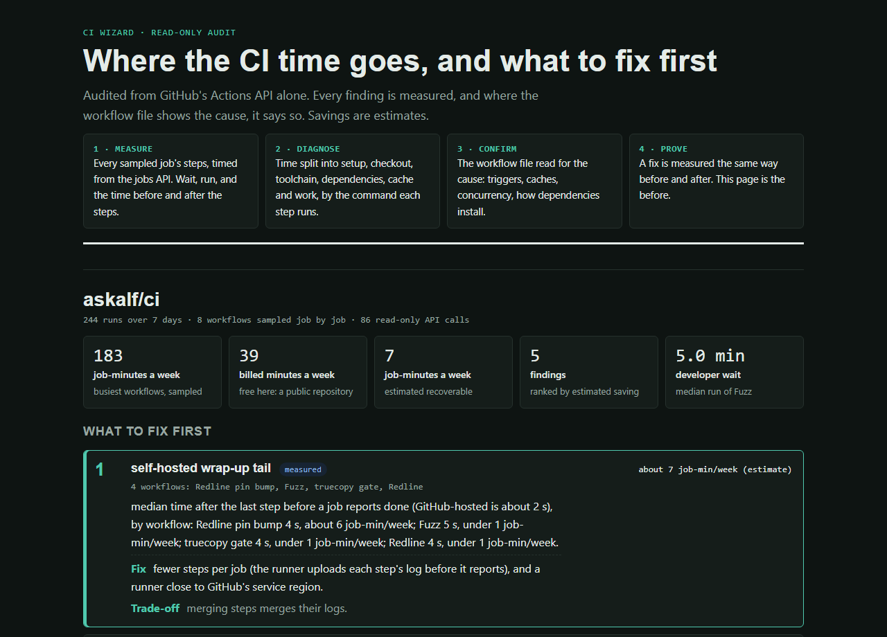

<div align="center">

# ci-wizard

**Where your GitHub Actions time goes, and what to fix first.**

[](https://github.com/askalf/ci-wizard/actions/workflows/ci.yml)
[](https://scorecard.dev/viewer/?uri=github.com/askalf/ci-wizard)
[](https://www.bestpractices.dev/projects/16408)
[](https://www.npmjs.com/package/ci-wizard)
[](LICENSE)

```sh
npx ci-wizard@0.4.4 owner/repo
```



</div>

ci-wizard reads a repository's workflow runs, jobs and workflow files from the GitHub API, times
every sampled step, and ranks what costs the most: installs with no cache, the same commit run
twice, outdated runs nobody cancels, a workflow that fires far more often than code changes. It
reads the workflow file for the cause before it says so, and it scans every workflow file for the
security mistakes a supply-chain review starts with.

- **Evidence, not hunches.** Every finding says where it is, what it saves, how it was measured, and how sure it is: *confirmed* by the workflow file, *measured*, or *cause inferred*.
- **A fix you can paste.** Each fix is an option with its trade-off, with YAML written for that workflow's own steps.
- **Proof after the change.** `--save` a baseline, make one change, audit again, and `compare` shows what moved.
- **Read-only.** GET requests to the GitHub API, and for two rules a HEAD or GET of a job log or artifact at the address GitHub redirects to. Nothing is cloned, nothing from the repository runs, nothing is written to it.
- **No dependencies at run time.** One bundled file. Releases are built in CI, with npm provenance and a Sigstore attestation.

## Contents

- [Quick start](#quick-start): the CLI, the GitHub Action, rate limits
- [What it finds](#what-it-finds): security risks, guards, savings
- [Reading a report](#reading-a-report)
- [The method](#the-method): measure, diagnose, confirm, prove
- [Security model](#security-model)
- [Requirements and limits](#requirements-and-limits)
- [Development](#development)

## Quick start

### From the command line

```sh
npx ci-wizard@0.4.4 owner/repo                          # the report, as markdown
npx ci-wizard@0.4.4 owner/repo --html audit.html        # also a self-contained page
npx ci-wizard@0.4.4 owner/repo --save before.json       # also a baseline for compare
npx ci-wizard@0.4.4 compare before.json after.json      # did the fix work?
```

The repository can be `owner/repo`, a GitHub URL or an SSH remote. Left out, it is the origin of the
checkout you run it in. The token comes from `GITHUB_TOKEN` or `GH_TOKEN`, otherwise from
`gh auth token`.

| Option | Default | |
| --- | --- | --- |
| `--days N` | `7` | days of runs to read |
| `--max-runs N` | `500` | the most runs read from those days, a multiple of 100 up to 1000. A busy repository fills 500 in a day or two |
| `--workflows N` | `8` | busiest workflows to time job by job |
| `--per-workflow N` | `5` | newest successful runs of each to time |
| `--only NAME` | | time only these workflows, by the name GitHub shows (repeat it, or separate names with commas) |
| `--json` | | print the report as JSON instead of markdown |
| `--save FILE` | | also save the JSON report, as a baseline for `compare` |
| `--html FILE` | | also write the report as an HTML page |
| `--fix FILE` | | also write the patches the report offers as one file for `git apply`: today, a concurrency group that cancels a pull request's outdated runs (see `docs/rules.md`) |

Exit codes: `0` report written, `1` repository not found or not readable, no runs in the window, or
an API error, `2` usage error, `3` stopped near the rate limit.

The GitHub CLI's token usually has write access to all your repositories. ci-wizard
sends it only with GET requests, but a fine-grained token with just **Actions: read** and
**Contents: read** is the least you can grant.

### As a GitHub Action

```yaml
name: CI audit
on:
  workflow_dispatch:
  schedule:
    - cron: '17 6 * * 1'
permissions:
  actions: read
  contents: read
jobs:
  audit:
    runs-on: ubuntu-latest
    timeout-minutes: 10
    steps:
      - uses: askalf/ci-wizard@ac4cff563323f818005aab0466b02ab54d6c4bce # v0.4.3
```

The report lands in the job summary, and in `$RUNNER_TEMP/ci-wizard/report.md` with `report.json`
beside it. An audit never fails the job for what it finds; it fails only when it cannot read the
repository.

| Input | Default | |
| --- | --- | --- |
| `repository` | the one the workflow runs in | `owner/name` |
| `token` | the job's token | needs `actions: read` and `contents: read` |
| `days` | `7` | days of runs to read (up to 500 runs) |
| `workflows` | `8` | busiest workflows to time job by job |
| `per-workflow` | `5` | newest successful runs of each to time |
| `only` | | workflow names, comma-separated, to time those instead |

Outputs: `report-path`, `findings`.

Pin the action to a release commit's full SHA, not to a tag: ci-wizard's own scan flags a tag pin,
because a tag can be moved to other code. `gh api repos/askalf/ci-wizard/commits/v0.4.3 --jq .sha`
prints the SHA of a release, and Dependabot or Renovate propose new pins as releases come.

### Rate limits

While GitHub reports the remaining count (api.github.com does), the client sends no more requests once
the token has 25 calls or fewer left, counting the ones in flight. That leaves at least 25 for the
repository's own CI, and the report says how many were left. An API that reports no count gives the
reserve nothing to hold against, so it can't be enforced, and the report says so.

**A GitHub App token for a larger budget.** A workflow's `GITHUB_TOKEN` has 1,000 requests an hour,
shared with every other step that calls the API. A GitHub App's installation token has its own 5,000
or more, and one App can audit many repositories. Create a private App with **Actions: read** and **Contents: read**, install it, keep
its client ID as a variable and its key as a secret, and mint a token in the job:

```yaml
    steps:
      - id: app
        uses: actions/create-github-app-token@64ab729a6294000f5aa4a4bc0b73d1f32bc45510 # v3.3.0
        with:
          client-id: ${{ vars.CI_WIZARD_APP_CLIENT_ID }}
          private-key: ${{ secrets.CI_WIZARD_APP_KEY }}
          owner: ${{ github.repository_owner }}
          permission-actions: read
          permission-contents: read
      - uses: askalf/ci-wizard@ac4cff563323f818005aab0466b02ab54d6c4bce # v0.4.3
        with:
          token: ${{ steps.app.outputs.token }}
```

The token lasts an hour and is revoked when the job ends.

## What it finds

Findings come in three groups, in this order. [docs/rules.md](docs/rules.md) gives each rule's
threshold, its confidence, how its saving is estimated, and the near misses it leaves alone.

**1. Security risks.** Ranked before any saving:

| Finding | What it means |
| --- | --- |
| actions not pinned to a commit | a `uses:` on a tag or branch, which its owner (or anyone who takes over the repository) can move to other code |
| untrusted input in a script | a pull request title, branch name, comment or commit message pasted into a `run:` or github-script, directly or through `env:` |
| job token wider than the job | `permissions: write-all`, or no permissions block, so the job gets the repository's default token |
| fork pull requests run on self-hosted runners | a fork's code can reach your runner |
| self-hosted runners reused across jobs | a persistent runner lets a job see what the one before left |
| merges do not wait for any check | pull requests get checks, but the default branch requires none, so a red pull request can merge |
| required checks no pull request reports | a required check bound to GitHub Actions that no recent completed pull request run produced (a renamed job, a path filter): GitHub waits for it forever |
| no workflow checks pull requests | no workflow file triggers on `pull_request`, and none ran on one |
| no code scanning | no CodeQL workflow and no default-setup run |
| no dependency updates | no Dependabot or Renovate configuration, so pinned actions never move to fixed versions |

**2. Savings.** Each is estimated from measured timings. The cause is confirmed against the workflow
file wherever the file says, and labelled *cause inferred* where it doesn't, such as a checkout
whose depth is set by an expression:

| Finding | |
| --- | --- |
| cache dependencies, dependency installs dominate | installs that run uncached, or dominate the job |
| slow checkout, toolchain setup | full history, LFS, submodules, a setup that could be cached, or a runtime setup on a self-hosted runner that has the runtime |
| test output floods the log | a passing job's log the size of a test listing, in megabytes a week |
| tests run twice, an artifact that duplicates another upload | the same one-command test step twice, confirmed by the run's logs listing the same tests; an artifact holding the one file another step already sent to code scanning or the release |
| the same commit runs twice, outdated runs keep going | push and pull request both firing; no cancel-in-progress |
| runs far more often than code changes, many small scheduled jobs | fixed cost paid on every run |
| short hosted jobs bill a whole minute, many short jobs, matrix size | GitHub rounds each hosted job up to a minute |
| self-hosted wrap-up tail, queue wait, reruns | time after the last step, waiting for a runner, flaky reruns |

**3. Guards.** They save no minutes, so they come after the savings that do:

| Finding | What it means |
| --- | --- |
| jobs without a working timeout | a hung job holds its runner for up to 6 hours before GitHub stops it |
| pull request checks merges do not wait for | a test, build, analysis or fuzzing check pull requests get that the default branch doesn't require, judged by its name |

## Reading a report

The same audit as the picture above, as the markdown report the CLI prints and the action writes to
the job summary (an excerpt of a run on [askalf/ci](https://github.com/askalf/ci), one of ours):

~~~markdown
# CI audit: askalf/ci

**Start with:** self-hosted wrap-up tail in *4 workflows: Redline pin bump, Fuzz, truecopy gate, Redline*: about 7 job-min/week (estimate).

The sampled workflows use about **183 job-minutes a week** (39 minutes on GitHub-hosted runners as GitHub rounds them, free on a public repository's standard runners). 3 findings would save about 7 of them (4%); 2 findings guard against merging a pull request whose checks fail and against hung jobs. Savings are estimates, and fixes can overlap, so they add up to an upper bound.

...

### 2. an artifact that duplicates another upload

**Where:** Scorecard  
**Saves** under 1 job-min/week (estimate) · **Confidence** measured  
**Why:** job analysis uploads results.sarif as the artifact "SARIF file" in "Upload artifact" (1 s a run) and sends the same file to code scanning, in a later step; the newest sampled run's artifact holds that one file (16 KB zipped).  
**Fix:** move the artifact step after the upload it duplicates and give it `if: failure()`, so the file is kept only on a run where that upload failed; where the upload comes first, drop the artifact step.  

```yaml
# after the step that sends results.sarif to code scanning
- name: "Upload artifact"
  if: failure()   # only when that upload failed
  uses: actions/upload-artifact@...
  with:
    path: "results.sarif"
```
~~~

- **Start with** names the one finding to fix first. The paragraph under it says what all the
  findings add up to against the job-minutes (and billed minutes) the sampled workflows use.
- **What to fix first** gives each finding's place, saving (job-minutes, billed minutes, or
  developer wait), confidence, evidence, fix, trade-off, and the YAML where the fix changes the
  workflow file.
- **Where the time goes** gives each workflow's runs a week, job-minutes and billed minutes,
  developer wait (only for workflows somebody waits on), queue wait, and the biggest shares of job
  time. † marks a workflow timed from fewer than 3 runs; ‡ marks one nobody waits on.
- **How it was measured** gives the API budget the audit drew on and how each figure is computed,
  and says what the security scans don't check, so an empty section isn't over-read.

The full result of that run is [docs/samples/askalf-ci.json](docs/samples/askalf-ci.json).

## The method

1. **Measure.** Each sampled job's steps are timed from the Actions API: queue wait, run time, and
   the time before the first step and after the last.
2. **Diagnose.** Time is split into runner overhead, checkout, toolchain, dependencies, cache,
   artifacts, docker and work. Each step is classified by the command it runs, read from the
   workflow file, not only by its name.
3. **Confirm.** The workflow file is parsed for the cause: triggers and push branch patterns,
   caches (a setup action's cache input too), concurrency and cancel-in-progress, how dependencies
   install, and whether a lockfile is committed. A commented-out step, or a feature switched off
   with `false`, never counts.
4. **Prove.** Save the report before the change (`--save before.json`). Let the change run for a
   while, measure again, and run `ci-wizard compare before.json after.json`. For each workflow it
   shows what moved, and which findings disappeared or appeared.

## Security model

People run this on their own repositories, so it is built to be safe to point at one, including one
that has a hostile contributor.

- **It only reads.** GET requests to the GitHub API, and for the log and artifact rules a HEAD or
  GET of the file at the address GitHub redirects to, with no token (every endpoint is listed below).
  Nothing is cloned, and nothing from the repository is run.
- **The token goes to GitHub alone,** as the `Authorization` header of those requests, to
  `api.github.com` or the https API that `GITHUB_API_URL` names (GitHub Enterprise Server). It is
  not logged, and not written to a report or an output.
- **It writes only what you ask for.** The CLI prints the report to stdout and writes only the files
  you name with `--save` or `--html`. The action writes only under `$RUNNER_TEMP/ci-wizard` and to
  the job summary.
- **Hostile names stay text.** Workflow, job and step names, file names and expressions come from
  whoever can push or open a pull request. Every report renders them as text (no markup, link, image,
  mention or terminal control code); the matching done on them takes linear time; each request has a
  30-second deadline and a 20 MB cap.
- **You can check the release.** Releases are built, tested and packed in GitHub Actions. The
  tarball carries a Sigstore attestation (`gh attestation verify <tarball> --owner askalf`), the npm
  package has npm provenance, `dist/` is rebuilt in CI and must match `src/` byte for byte, and every
  action this repository uses is pinned to a commit.

[SECURITY.md](SECURITY.md) lists what is in scope, and how to report a vulnerability privately.

<details>
<summary><b>Every endpoint it reads</b></summary>

- `GET /repos/{repo}/actions/runs` (up to 500 runs, or the CLI's `--max-runs` up to 1000),
  `/actions/runs/{id}/jobs` and `/actions/workflows`;
- `/actions/runs/{id}/jobs?filter=all` for up to 3 re-attempted runs of each sampled workflow: the
  jobs of every attempt, for what the later attempts re-ran;
- `/actions/jobs/{id}/logs` for the jobs of each sampled workflow's newest successful run: the
  redirect it answers with, then a HEAD of the log file's address (no token) for its size. The log
  itself is downloaded (from that address, no token, up to 8 MB) only for a job the workflow file
  names in a candidate for the tests-run-twice rule, and read for the tests its steps list;
- `/actions/runs/{id}/artifacts` and `/actions/artifacts/{id}/zip` only where a workflow file names
  a candidate for the duplicate-upload rule: the newest successful run's listing, then the candidate
  artifact's zip (from the redirect's address, no token, up to 8 MB), read for the names in its
  directory and never opened;
- `/contents/.github/workflows`, the workflow files (up to 30), the root listing (to see which
  lockfile is committed) and the `.github` listing (for Dependabot's configuration);
- `/repos/{owner}/{repo}/contents/.github/workflows/{file}?ref={ref}` for a reusable workflow a job
  calls in another repository (up to 12 files, four calls deep), read for whether it runs a code
  scanner and how it scopes the job token;
- `/repos/{repo}` (default branch and visibility);
- `/rules/branches/{default branch}` and `/branches/{default branch}`, for the checks a merge must
  wait for. These need only the read access every token has.

YAML is parsed by the bundled yaml library, with its alias limits. A job's log and an artifact's
directory are a step's own output, read only to confirm what the workflow file already shows twice:
the test names or counts in two step sections, the file names in the zip. Forged output can keep
those rules silent, or make two steps the file shows as identical read as one; it reaches nothing
else, and every fix is a workflow change the reader makes, never an action the tool takes.

</details>

## Requirements and limits

- **Token.** **Actions: read** and **Contents: read**. A workflow's own `GITHUB_TOKEN` is enough for
  the repository it runs in. A repository the token cannot see reads as not found.
- **Node.** The CLI needs Node 20 or later. The action runs on the runner's Node 24. Behind a proxy
  (`HTTPS_PROXY`, as on many self-hosted runners) both use it on Node 22.21 and later, and warn that
  it is ignored on an older Node.
- **Cost.** About 25 to 150 API calls at the default 500 runs, more with more busy workflows, large
  matrices and reruns (audits of ten large public repositories took 24 to 144), made up to six at a
  time: about 10 seconds for 500 runs. Each 100 runs more with `--max-runs` is one more page of the
  runs list, and the other calls can rise too when the longer window changes which workflows are the
  busiest.
- **Sampled.** The window is up to 500 runs (1000 with `--max-runs`, the most GitHub serves for a
  runs list filtered by date). Weekly figures scale the window to 7 days; a busy repository's 500
  runs can cover less than a day, so its figures are noisier, and the report says when the cap cut
  the window short. Job-level timing comes from a few recent successful runs of each busy workflow,
  plus up to two failed, cancelled and timed-out runs each, for their cost.
- **Estimates.** Savings come from simple formulas over measured time, not from running the fix.
  Only `compare`, run after the change, proves one.
- **Billed minutes are minutes, not money.** They round each hosted job up as GitHub does, but larger
  runners, Windows and macOS cost more per minute, and a plan's included minutes are not subtracted.
  A public repository's standard runners are free, and the report says so.
- **The scans are a first pass, not an audit.** They don't check `pull_request_target` or
  `workflow_run` jobs that run a fork's code or artifacts, composite actions under `.github/actions`,
  or reusable workflows in other repositories beyond whether they run a code scanner and how they
  scope the job token. Fork exposure and runner reuse are judged from the sampled workflows.
- **Options, not orders.** A fix can disagree with a repository's own history: a status job may keep
  cancel-in-progress off on purpose.

## Development

```sh
npm ci
npm test          # node:test, no network
npm run build     # bundles src/ into dist/ (committed; the action runs from it)
```

See [CONTRIBUTING.md](CONTRIBUTING.md). Security reports go through [SECURITY.md](SECURITY.md).

## License

MIT
